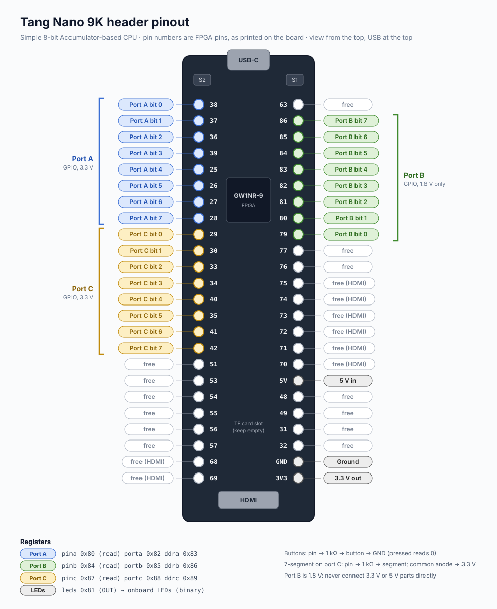

# Simple 8-bit Accumulator-based CPU

An 8-bit accumulator-based CPU with a Harvard architecture, written in Verilog for the **Sipeed Tang Nano 9K** (Gowin GW1NR-9 FPGA).

Specification: [`docs/Design Guide.pdf`](docs/Design%20Guide.pdf)  
Control signals per instruction: [`docs/Control Unit Signal Table.pdf`](docs/Control%20Unit%20Signal%20Table.pdf)  
Netlist schematics: [`docs/cpu_netlist.svg`](docs/cpu_netlist.svg) (CPU), [`docs/top_tang9k_netlist.svg`](docs/top_tang9k_netlist.svg) (board top level)  
Board pinout with the port assignments: [`docs/tang9k_pinout.svg`](docs/tang9k_pinout.svg)

## Features

- **8-bit data path** built around a single accumulator (ACC)
- **Harvard architecture:** separate instruction ROM (256 × 12-bit) and data memory (256 × 8-bit, with an I/O block at `0x80`–`0x8F`)
- **12-bit instructions:** 4-bit opcode + 8-bit operand, 16 instructions; addressing mode encoded in the opcode
- **3-state control cycle:** FETCH, EXECUTE, WRITEBACK (2 or 3 clocks per instruction), plus a HALT state
- **Zero (Z) and Carry (C) flags** for conditional skips
- **Memory-mapped I/O:** three 8-bit GPIO ports (each pin input or output, set by a direction register) and an output register for the onboard LEDs
- **Runs on the Tang Nano 9K** at the full 27 MHz board clock, or slowed down with a clock divider

## Instruction set

Format: `[11:8]` opcode, `[7:0]` operand (address, immediate value or option bits).

| Opcode | Mnemonic | Operation |
| --- | --- | --- |
| `0x0` | ADD | ACC ← ACC + MEM[addr] |
| `0x1` | SUB | ACC ← ACC − MEM[addr] |
| `0x2` | AND | ACC ← ACC & MEM[addr] |
| `0x3` | OR | ACC ← ACC \| MEM[addr] |
| `0x4` | ADDI | ACC ← ACC + imm |
| `0x5` | SUBI | ACC ← ACC − imm |
| `0x6` | ANDI | ACC ← ACC & imm |
| `0x7` | ORI | ACC ← ACC \| imm |
| `0x8` | LD | ACC ← MEM[addr] |
| `0x9` | STE | MEM[addr] ← ACC |
| `0xA` | LDI | ACC ← imm |
| `0xB` | GOTO | PC ← addr |
| `0xC` | SKIP | Skip next instruction if the selected flag equals operand[1] (operand[0]: 0 = Z, 1 = C) |
| `0xD` | NOT | ACC ← ~ACC |
| `0xE` | CTL | 0 = NOP, 1 = HALT |
| `0xF` | CLR | 0 = clear ACC, 1 = clear flags |

Opcode bit 2 selects the operand for ALU instructions: `0x0`–`0x3` read data memory, `0x4`–`0x7` use the immediate. SKIP operands: `0x00` skip if Z = 0, `0x02` skip if Z = 1, `0x01` skip if C = 0, `0x03` skip if C = 1. INC and DEC are written as `ADDI 0x01` and `SUBI 0x01`.

## Memory map (data memory)

| Address | Register | Read (`LD`) | Write (`STE`) |
| --- | --- | --- | --- |
| `0x00`–`0x7F` | RAM | RAM | RAM |
| `0x80` | PINA | port A pin levels | ignored |
| `0x81` | OUT | output register | value shown on the onboard LEDs |
| `0x82` | PORTA | port A output register | values driven on port A output pins |
| `0x83` | DDRA | port A direction | 1 = output, 0 = input, per pin |
| `0x84` | PINB | port B pin levels | ignored |
| `0x85` | PORTB | port B output register | values driven on port B output pins |
| `0x86` | DDRB | port B direction | 1 = output, 0 = input, per pin |
| `0x87` | PINC | port C pin levels | ignored |
| `0x88` | PORTC | port C output register | values driven on port C output pins |
| `0x89` | DDRC | port C direction | 1 = output, 0 = input, per pin |
| `0x8A`–`0x8F` | reserved | `0x00` | ignored |
| `0x90`–`0xFF` | RAM | RAM | RAM |

Reset clears every I/O register, so all GPIO pins start as inputs. `0x80` (input) and `0x81` (output) keep their original meaning, so Tests A, B and C are unchanged.

### Using a GPIO port

```
        LDI  0xF0       ; pins 7..4 outputs, pins 3..0 inputs
        STE  0x86       ; DDRB
        LD   0x80       ; read port A pins
        STE  0x85       ; drive port B output pins
```

The pins have internal pull-ups: a button wired from a pin to GND reads 1 when released and 0 when pressed.

## Programs

| File | What it does |
| --- | --- |
| `programs/test_a.hex` | Test A: counts down from 5 to 0, writing each value to the output device, then halts |
| `programs/test_b.hex` | Test B: addition and subtraction through data memory |
| `programs/test_c.hex` | Test C: reads the input device, adds 1, writes the output device |
| `programs/test_gpio.asm` / `.hex` | GPIO test: copies port A to port B (pins 7..4 outputs) and port C (all outputs), and shows the port B pins on the LEDs |
| `programs/1sec_countdown.asm` / `.hex` | Board demo at 27 MHz: counts 5 to 0 on the LEDs, exactly one count per second, forever |
| `programs/buttons.asm` / `.hex` | Board demo: the LEDs show which port A buttons are pressed |
| `programs/press.asm` / `.hex` | Board demo: every press of the button on pin 38 adds 1 on the LEDs, with about 15 ms of debounce |

On the board, the onboard LEDs show the OUT register (`0x81`). A 7-segment display or other parts connect to the GPIO ports and are driven by the program: for a common-anode display, the segments go to port C through resistors and the program writes the inverted segment pattern to PORTC.

## Repository structure

```
rtl/
  core/       CPU: program counter, instruction register and decoder, control unit, ALU, accumulator, flags, muxes, cpu.v
  memory/     instruction ROM, data RAM, and the data bus that routes CPU accesses to RAM or the I/O block
  periph/     peripherals: GPIO port, synchronizer, clock divider
  board/      Tang Nano 9K top level
sim/          Testbenches
programs/     Assembly sources (.asm) and machine-code programs (.hex) for instruction memory
constraints/  Tang Nano 9K pin constraints (.cst)
fpga/         Gowin EDA project
docs/         Design guide, control unit signal table and netlist schematic
tools/        Assembler (asm.c) and schematic generator
```

## Simulation

Run from the repository root with Icarus Verilog. In PowerShell, compile a testbench together with all the RTL files:

```powershell
$rtl = (Get-ChildItem rtl -Recurse -Filter *.v).FullName
iverilog -g2012 -s tb_cpu -o tb_cpu.vvp sim\tb_cpu.v $rtl;  if ($?) { vvp tb_cpu.vvp }
gtkwave tb_cpu.vcd
```

In a Unix shell: `iverilog -g2012 -s tb_cpu -o tb_cpu.vvp sim/tb_cpu.v rtl/*/*.v && vvp tb_cpu.vvp`. `-s` names the testbench as the only top module; without it, Icarus also elaborates the unused board top level and reports that it cannot open its program file. Each testbench prints `PASS` or the failing checks.

| Testbench | What it verifies |
| --- | --- |
| `tb_alu.v` | every ALU operation, including the Z and C flags |
| `tb_registers.v` | program counter, instruction register, accumulator and flag register |
| `tb_instruction_memory.v` | ROM contents loaded from `test_a.hex` |
| `tb_data_memory.v` | the RAM: writes, write enable, asynchronous reads over the whole address range |
| `tb_gpio.v` | one GPIO port: PORT and DDR written and read back, PIN following the pins, other addresses ignored, reset |
| `tb_data_bus.v` | the whole data path: RAM, the GPIO and OUT registers, read-only PIN registers, reserved addresses, reset |
| `tb_control_unit.v` | control signals and next state for every instruction and state |
| `tb_cpu.v` | the whole CPU running Tests A, B and C |
| `tb_clock_divider.v` | divided clock period, duty cycle and reset |
| `tb_synchronizer.v` | two-clock delay, back-to-back changes, short pulses, independent bits |
| `tb_top_tang9k.v` | the board top level: Test C through the clock divider and synchronizers, and `test_gpio.hex` on the tri-state GPIO pins |

## Assembler

`tools/asm.c` turns an assembly source into a `.hex` file for instruction memory. Build it once with gcc, then assemble:

```
gcc -Wall -Wextra -o tools/asm.exe tools/asm.c
tools/asm.exe programs/press.asm programs/press.hex
```

It supports labels (`loop:`), comments (`;`), hexadecimal (`0x2A`), decimal and binary operands, and the special forms `NOT`, `NOP`, `HALT`, `CLRA`, `CLRF` and `SKIP Z=0`/`Z=1`/`C=0`/`C=1` (INC and DEC are written as `ADDI 0x01` and `SUBI 0x01`). Errors are reported with the line number.

## Building for the Tang Nano 9K

The board top level `rtl/board/top_tang9k.v` contains:

- **CPU clock:** the 27 MHz board clock directly (`DIVISOR = 1`), or divided by `clock_divider` for slow, visible stepping
- **Reset:** S1, synchronized to the CPU clock (`synchronizer.v`); the CPU also resets itself at power-up
- **GPIO:** three 8-bit ports with tri-state pins; pin levels are synchronized before the CPU reads them
- **LEDs:** the six onboard LEDs show OUT[5:0] in binary (active-low)

1. Open `fpga/fpga/fpga.gprj` in Gowin EDA (device GW1NR-LV9QN88PC6/I5, version C).
2. Choose the program with the `PROGRAM` parameter in `rtl/board/top_tang9k.v`, e.g. `"../../programs/1sec_countdown.hex"` (paths are relative to the Gowin project folder).
3. Run Synthesize, then Place & Route.
4. Open Programmer and load the bitstream (SRAM for a quick test, embedded flash to keep it after power-off).
5. Press S1 to restart the program.

The Gowin project includes all files in `rtl/` and its subfolders, the pin constraints `constraints/tang9k.cst` and the timing constraint `constraints/tang9k.sdc` (27 MHz clock). The paths are relative to the project folder, so the project opens wherever the repository is cloned. Pins 54–57 (SSPI configuration pins) are not used, so no dual-purpose pin setting is needed. A program must write the OUT register or a GPIO port; otherwise synthesis removes the whole CPU as logic without outputs.

### Wiring



| Signal | FPGA pins | Connection |
| --- | --- | --- |
| `gpio_a[7:0]` | 38, 37, 36, 39, 25, 26, 27, 28 | port A, 3.3 V; e.g. buttons to GND through 1 kΩ |
| `gpio_c[7:0]` | 29, 30, 33, 34, 40, 35, 41, 42 | port C, 3.3 V; e.g. 7-segment segments a–dp through 1 kΩ |
| `gpio_b[7:0]` | 79, 80, 81, 82, 83, 84, 85, 86 | port B, **1.8 V** (bank 3) |

Ports A and C run down the left header row, port A first (bit 0 at pin 38, the top-left pin) and port C right below it. Port B is on bank 3, which runs at 1.8 V, so 3.3 V parts on port B need a level shifter. Pins 51–57, 68–75 (shared with HDMI) and 17–18 (USB-UART) are left free. Pins 36–39 are shared with the TF card slot, so leave it empty. The 1 kΩ in series with each button protects the pin if a program sets it as an output driving 1.

## Progress

### RTL

- [x] Program counter (`program_counter.v`)
- [x] Instruction register (`instruction_register.v`)
- [x] Instruction decoder (`instruction_decoder.v`)
- [x] Accumulator (`accumulator.v`)
- [x] Flag register (`flag_register.v`)
- [x] ALU (`alu.v`)
- [x] N-to-1 multiplexer (`nto1mux.v`)
- [x] Instruction memory (`instruction_memory.v`)
- [x] Data memory, RAM only (`data_memory.v`)
- [x] Data bus: RAM or the memory-mapped I/O block (`data_bus.v`)
- [x] Timing and control unit (FSM)
- [x] CPU top level (`cpu.v`)
- [x] Clock divider (`clock_divider.v`)
- [x] Tang Nano 9K top level (`top_tang9k.v`)
- [x] Two flip-flop synchronizer (`synchronizer.v`)
- [x] GPIO port module (`gpio.v`), used for ports A, B and C
- [x] RTL organized into `core/`, `memory/`, `periph/` and `board/`

### Verification

- [x] ALU testbench
- [x] Registers testbench (PC, IR, ACC, flags)
- [x] Instruction memory testbench
- [x] Data memory testbench
- [x] Control unit testbench
- [x] Test A: countdown from 5 to 0 on the output device, then halt
- [x] Test B: addition and subtraction through memory
- [x] Test C: memory-mapped I/O
- [x] Clock divider testbench
- [x] Board top level testbench (clock divider, reset synchronizer, CPU and LEDs)
- [x] Data bus testbench with the GPIO and OUT registers
- [x] GPIO port testbench
- [x] Board top level testbench with GPIO (tri-state outputs, pulled-up inputs, read-back)
- [x] Synchronizer testbench

### Hardware

- [x] Tang Nano 9K pin constraints
- [x] Synthesis and on-board test
- [x] Full-speed 27 MHz operation (timing: about 62 MHz maximum)
- [x] GPIO wired and tested on the board (buttons, LEDs, 7-segment display on port C)

### Software

- [x] Assembler: assembly source to `.hex` for instruction memory (`tools/asm.c`)
- [ ] Browser simulator: write, assemble and step through programs; view PC, IR, ACC, flags and memory
- [ ] Cross-check simulator against RTL using Tests A, B and C

## Tools

- **Synthesis / place and route:** Gowin EDA
- **Simulation:** Icarus Verilog + GTKWave
- **Assembler:** `tools/asm.c`, built with gcc
- **Schematic:** Yosys + ELK (`schematic.ps1`)
